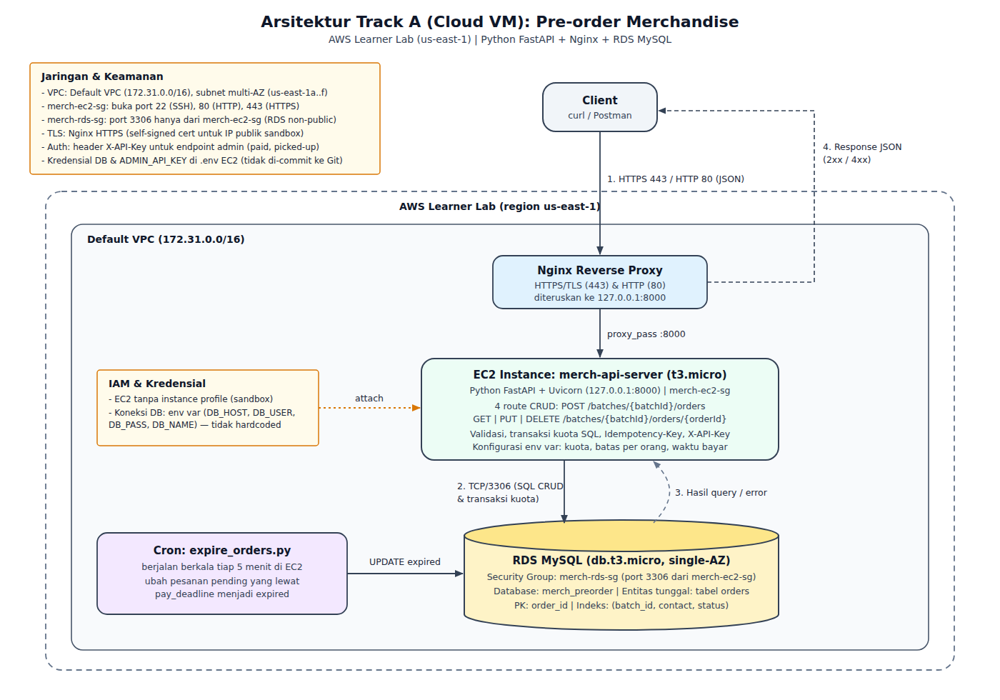

# Pre-order Merchandise (Track A: Cloud VM)

Sistem manajemen pre-order (PO) merchandise berkuota untuk himpunan/UKM kampus yang dibangun di AWS (`us-east-1`) menggunakan arsitektur **Track A (Cloud VM)**: **EC2 + RDS MySQL + Nginx + Python FastAPI**.

## Arsitektur



- **Entitas tunggal:** `Order` pada tabel `orders` (primary key `order_id`, indeks `(batch_id, contact, status)` dan `(status, pay_deadline)`).
- **Keamanan:** `merch-ec2-sg` (port `22`, `80`, `443`), `merch-rds-sg` (port `3306` hanya dari `merch-ec2-sg`, RDS *non-public*), akses admin (`paid`, `picked-up`) dilindungi `X-API-Key`, dan kredensial DB disimpan di `.env` lokal EC2.

## Fitur & Aturan Bisnis Utama

- **Kuota & batas per orang atomik:** transaksi SQL (`BEGIN` + `SELECT ... FOR UPDATE`) memastikan total pesanan aktif (`pending` + `paid`) tidak melebihi `PO_QUOTA` dan satu nomor HP tidak melebihi `PER_PERSON_LIMIT`.
- **Idempotensi:** header `Idempotency-Key` pada `POST` mencegah pesanan ganda jika request dikirim ulang.
- **Siklus status:** `pending → paid → picked-up`, pembatalan *soft delete* (`cancelled`) yang aman dipanggil berulang, dan `cron` `expire_orders.py` untuk menandai pesanan lewat `pay_deadline` menjadi `expired`.

## Endpoint API

| Method & Path | Fungsi | Keterangan |
|---|---|---|
| `GET /health` | Cek API & koneksi RDS MySQL | Mengembalikan status `ok` jika DB terhubung |
| `POST /batches/{batchId}/orders` | Buat pesanan baru (`pending`) | Mendukung header `Idempotency-Key` |
| `GET /batches/{batchId}/orders` | Daftar pesanan satu batch | Mendukung parameter `limit` |
| `GET /batches/{batchId}/orders/{orderId}` | Detail satu pesanan | `404` jika tidak ditemukan |
| `PUT /batches/{batchId}/orders/{orderId}` | Ubah `size` atau status (`paid`, `picked-up`) | Transisi status wajib header `X-API-Key` |
| `DELETE /batches/{batchId}/orders/{orderId}` | Batalkan pesanan (`cancelled`) | *Soft delete*, idempoten (`409` jika sudah akhir) |

## Environment Variables

Aplikasi membaca konfigurasi berikut (tidak disimpan di Git):

```env
DB_HOST=<rds-endpoint>
DB_PORT=3306
DB_USER=admin
DB_PASS=<password>
DB_NAME=merch_preorder

PO_OPEN=true
PO_QUOTA=50
PER_PERSON_LIMIT=2
PAY_WINDOW_HOURS=24
ADMIN_API_KEY=<secret-admin-key>
```

## Struktur Repositori

```
kompaw/
├── README.md
├── .gitignore
├── sql/
│   └── schema.sql            # DDL tabel orders + indeks
├── src/
│   ├── app.py                # FastAPI endpoints & transaksi SQL
│   ├── db.py                 # Helper koneksi PyMySQL
│   └── expire_orders.py      # Cron script untuk pesanan expired
├── nginx/
│   └── merch-preorder.conf   # Reverse proxy HTTP/HTTPS -> 127.0.0.1:8000
├── scripts/
│   ├── aws_setup.sh          # Provisioning SG, DB Subnet Group, RDS, EC2 (us-east-1)
│   ├── ec2_bootstrap.sh      # Setup Python, Nginx, TLS cert, systemd, & cron di EC2
│   └── rebuild_all.sh        # One-command rebuild & verifikasi setelah sandbox reset
├── tests/
│   └── test_api.sh           # Pengujian curl end-to-end
├── evidence/                 # Screenshot AWS & output pengujian
└── requirements.txt
```

## Rencana Deployment (AWS Sandbox `us-east-1`)

Karena AWS Learner Lab / sandbox menghapus resource saat sesi berakhir, provisioning dibuat repeatable lewat satu perintah:

```bash
DB_PASS='PasswordAman123!' ADMIN_API_KEY='kunci-admin' ./scripts/rebuild_all.sh
```

Secara otomatis `rebuild_all.sh` menjalankan 3 tahap berikut:

1. **Provisioning infrastruktur (`scripts/aws_setup.sh`):** membuat `merch-ec2-sg`, `merch-rds-sg`, `merch-preorder-sng`, instance **RDS MySQL** (`db.t3.micro`), key pair, dan instance **EC2** (`t3.micro`).
2. **Inisialisasi database & aplikasi (`scripts/ec2_bootstrap.sh`):** menyalin kode & `.env` ke EC2, menjalankan `sql/schema.sql` ke RDS endpoint, serta memasang FastAPI service, Nginx (HTTP/HTTPS), dan `cron` `expire_orders.py`.
3. **Verifikasi konektivitas (`tests/test_api.sh`):** menguji seluruh endpoint CRUD, transaksi kuota, idempotensi, dan koneksi ke RDS MySQL lewat `https://<EC2_PUBLIC_IP>`.

